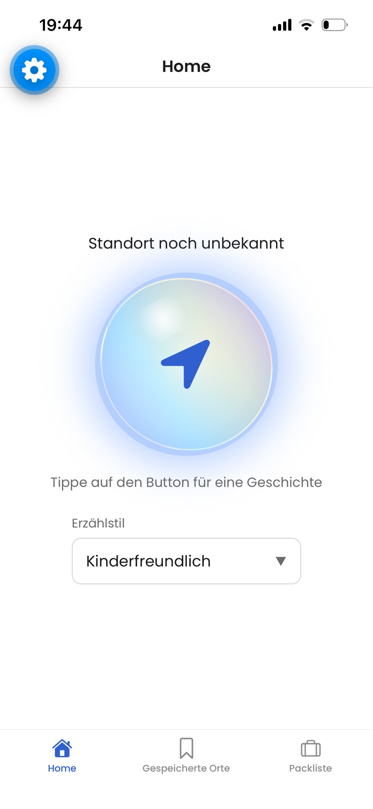
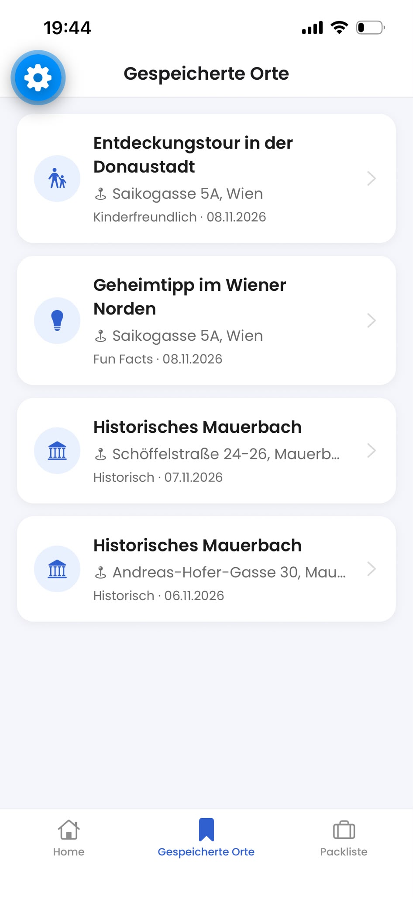
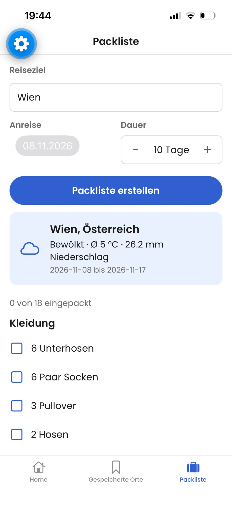

# WayTales

**Ortsbezogene KI-Kurzgeschichten für unterwegs – mit Vorlesefunktion, Offline-Speicher und wetterbasiertem Pack-Assistenten.**

WayTales ermittelt per GPS, wo du gerade stehst, und lässt sich von Google Gemini eine kurze Geschichte über diesen Ort erzählen – wahlweise **historisch**, als **Fun Facts** oder **kinderfreundlich**. Geschichten können vorgelesen, gespeichert und später auch ohne Internet wieder geöffnet werden. Der Pack-Assistent erstellt aus Reiseziel, Datum und Wettervorhersage eine abhakbare Packliste.

Semesterprojekt im Kurs **Cross Platform Development**, FH Technikum Wien, WS 2026.
Team: Anja Gfrerer, Rilind Mehmeti
Die vollständige Projektspezifikation inkl. Changelog der Abweichungen wurde über Moodle abgegeben.

<p align="center">
  
  
  
</p>

---

## Inhalt

- [Features](#features)
- [User Stories → Code](#user-stories--code)
- [Mindestanforderungen](#mindestanforderungen)
- [Tech-Stack](#tech-stack)
- [Setup & Start](#setup--start)
- [Ausprobieren](#ausprobieren)
- [Architektur](#architektur)
- [Native Features & Berechtigungen](#native-features--berechtigungen)
- [Offline & Persistenz](#offline--persistenz)
- [Fehlerbehandlung](#fehlerbehandlung)
- [Tests](#tests)
- [Mock-Daten](#mock-daten)
- [Datenschutz](#datenschutz)
- [Bekannte Einschränkungen & Entscheidungen](#bekannte-einschränkungen--entscheidungen)

---

## Features

| Feature | Beschreibung |
|---|---|
| **Stilauswahl** | Dropdown mit drei Erzählstilen. Die Auswahl liegt im globalen Store und bleibt beim Tabwechsel und nach einem Neustart erhalten. |
| **Geschichte generieren** | GPS-Position + Stil → Gemini. Ladeindikator während der Anfrage, Ergebnis im Modal mit Titel, Ortsname und „Mehr erfahren“. |
| **Vorlesen** | Play/Stop per Sprachausgabe (Deutsch). Das Icon wechselt, die Wiedergabe stoppt beim Schließen von Modal oder Screen. |
| **Speichern** | Geschichte mit einem Tipp lokal speichern. Der Button zeigt danach „Gespeichert“, Duplikate werden verhindert. |
| **Gespeicherte Orte** | Liste aller gespeicherten Geschichten, funktioniert auch im Flugmodus. Detailansicht mit Volltext, Vorlesen, Löschen und Link zur Karten-App. |
| **Pack-Assistent** | Reiseziel + Anreisedatum + Dauer → Ort suchen → Wettervorhersage → KI-Packliste mit abhakbaren Einträgen. Häkchen bleiben gespeichert. |
| **Offline-Modus** | Offline-Banner, Generieren-Buttons werden deaktiviert, gespeicherte Geschichten bleiben les- und vorlesbar. Ohne Netz zeigt der Pack-Screen eine allgemeine Basis-Packliste. |

---

## User Stories → Code

| # | User Story | Umgesetzt in | Tests |
|---|---|---|---|
| 1 | Stilauswahl | `src/components/StyleDropdown.tsx`, `src/store/useSettingsStore.ts`, `src/constants/styles.ts`, `src/app/(tabs)/index.tsx` | `StyleDropdown.test.tsx`, `prompts.test.ts` |
| 2 | Geschichte generieren | `src/app/(tabs)/index.tsx`, `src/components/StoryModal.tsx`, `src/hooks/useLocation.ts`, `src/services/locationService.ts`, `src/services/aiService.ts`, `src/constants/prompts.ts`, `src/utils/errorMessages.ts` | `aiService.test.ts`, `prompts.test.ts`, `locationService.test.ts`, `useLocation.test.ts` |
| 3 | Vorlesen | `src/components/SpeakButton.tsx`, `src/hooks/useSpeech.ts`, `src/services/ttsService.ts`, `src/components/StoryModal.tsx`, `src/app/story-detail.tsx` | – |
| 4 | Geschichte speichern | `src/components/StoryModal.tsx`, `src/store/useStoryStore.ts`, `src/services/storageService.ts` | `StoryModal.test.tsx`, `useStoryStore.test.ts`, `storageService.test.ts` |
| 5 | Gespeicherte Orte offline | `src/app/(tabs)/saved.tsx`, `src/app/story-detail.tsx`, `src/components/StoryListItem.tsx`, `src/hooks/useSavedStories.ts`, `src/services/mapService.ts` | `useStoryStore.test.ts`, `mapService.test.ts` |
| 6 | Navigation | `src/app/_layout.tsx`, `src/app/(tabs)/_layout.tsx` | – |
| 7 | Pack-Assistent | `src/app/(tabs)/pack.tsx`, `src/services/weatherService.ts`, `src/services/aiService.ts`, `src/store/usePackingStore.ts`, `src/components/WeatherCard.tsx`, `src/components/PackingChecklist.tsx` | `weatherService*.test.ts`, `aiService.test.ts`, `usePackingStore.test.ts` |
| 8 | Offline-Hinweis | `src/hooks/useNetworkStatus.ts`, `src/components/OfflineBanner.tsx`, `src/app/(tabs)/index.tsx`, `src/app/(tabs)/pack.tsx`, `src/constants/basicPackingList.ts` | `useNetworkStatus.test.ts`, `usePackingStore.test.ts` |

---

## Mindestanforderungen

| Anforderung | Umsetzung |
|---|---|
| ≥ 3 Screens mit strukturierter Navigation | 4 Screens: 3 Tabs + Detail-Modal (Expo Router) |
| Kontrollierter State | Zustand: `useStoryStore`, `useSettingsStore`, `usePackingStore` |
| Externe Datenquelle | Google Gemini, Open-Meteo Geocoding und Forecast |
| ≥ 1 Device-Capability | GPS (`expo-location`), Sprachausgabe (`expo-speech`), Netzwerkstatus (`expo-network`) |
| Lokale Persistenz, Kern funktioniert offline | AsyncStorage über Zustand `persist`; gespeicherte Geschichten und Packliste offline nutzbar |
| Basis-Tests | 87 Tests in 14 Dateien (Jest + React Native Testing Library) |
| Stabil auf Gerät / Emulator | Getestet auf iPhone und Android-Emulator, siehe [Getestete Plattformen](#getestete-plattformen) |

---

## Tech-Stack

| Bereich | Technologie |
|---|---|
| Framework | [Expo](https://expo.dev) SDK 58, React Native 0.88, React 19 |
| Sprache | TypeScript |
| Navigation | Expo Router (dateibasiert, Stack + Tabs) |
| State Management | [Zustand](https://zustand.docs.pmnd.rs/) mit `persist`-Middleware |
| Persistenz | `@react-native-async-storage/async-storage` |
| HTTP | Axios (zentrale Client-Factory mit Timeout) |
| KI | Google Gemini (REST, JSON-Modus) |
| Wetter & Geocoding | Open-Meteo Forecast API und Geocoding API (kein Key nötig) |
| Native Module | `expo-location`, `expo-speech`, `expo-network`, `expo-linking` |
| Tests | Jest, `jest-expo`, React Native Testing Library |
| Code-Qualität | ESLint (`eslint-config-expo`), TypeScript Strict Mode |

---

## Setup & Start

### Voraussetzungen

- [Node.js](https://nodejs.org/) (aktuelle LTS-Version) und npm
- Smartphone mit **Expo Go** (passend zu SDK 58) **oder** Android-Emulator / iOS-Simulator
- Ein kostenloser **Gemini-API-Key** aus [Google AI Studio](https://aistudio.google.com/apikey)

### Installation

```bash
git clone https://github.com/r1l1nd/waytales.git
cd waytales
npm install
```

### Umgebungsvariablen

Die Datei `.env` ist nicht im Repository (siehe `.gitignore`). Vorlage kopieren und den eigenen Gemini-Key eintragen:

```bash
cp .env.example .env
```

| Variable | Bedeutung |
|---|---|
| `EXPO_PUBLIC_GEMINI_API_KEY` | Eigener API-Key aus Google AI Studio |
| `EXPO_PUBLIC_GEMINI_API_URL` | Basis-URL der Gemini-API |
| `EXPO_PUBLIC_GEMINI_MODEL` | Verwendetes Gemini-Modell |
| `EXPO_PUBLIC_GEOCODING_API_URL` | Open-Meteo Geocoding (Ort → Koordinaten) |
| `EXPO_PUBLIC_FORECAST_API_URL` | Open-Meteo Wettervorhersage |

> Ohne gültigen Key zeigt die App eine verständliche Fehlermeldung. Zum Ausprobieren ohne Key können die [Mock-Daten](#mock-daten) aktiviert werden.

### Starten

```bash
npx expo start
```

Danach den QR-Code mit Expo Go scannen (Android) bzw. mit der Kamera-App (iOS), oder im Terminal `a` (Android-Emulator) bzw. `i` (iOS-Simulator) drücken.

### Weitere Befehle

```bash
npm test             # alle Tests ausführen
npx expo lint        # Linting
npx tsc --noEmit     # Typprüfung
```

### Getestete Plattformen

| Gerät | System | Umgebung |
|---|---|---|
| iPhone 14 | iOS 26.5 | Expo Go |
| Android-Emulator Pixel 4 | Android 13 (API 33) | Expo Go |

---

## Ausprobieren

- **Geschichte:** Stil wählen → GPS-Button tippen → Standort erlauben → Geschichte im Modal lesen, vorlesen, speichern
- **Offline:** Flugmodus einschalten → Offline-Banner erscheint, Generieren-Buttons sind deaktiviert, gespeicherte Orte bleiben lesbar
- **Berechtigung:** Standort ablehnen → Hinweis; dauerhaft ablehnen → Button „Einstellungen öffnen“
- **Packliste:** Reiseziel und Datum eingeben → Packliste erstellen → Häkchen setzen, Tab wechseln und App neu starten → Häkchen bleiben
- **Fehlerfälle:** Unbekanntes Reiseziel oder Reise länger als 16 Tage in der Zukunft → verständlicher Hinweis

---

## Architektur

### Grundidee

Die App folgt einem **unidirektionalen Datenfluss**: Eine Aktion im Screen ruft einen Hook oder Store auf, dieser nutzt einen Service, das Ergebnis landet im State und die UI rendert neu.

```
Screen (UI)  →  Hook / Store (State)  →  Service (Zugriff nach außen)  →  API / Gerät / Speicher
     ↑                    │
     └──── re-render ─────┘
```

- **Screens** bleiben schlank und kümmern sich nur um Darstellung und Benutzereingaben.
- **Hooks** kapseln Geräte-Logik samt Lade- und Fehlerzustand (`useLocation`, `useNetworkStatus`, `useSpeech`).
- **Services** sind die einzige Stelle, die externe Systeme kennt (Gemini, Open-Meteo, GPS, Sprachausgabe, AsyncStorage). Dadurch lassen sie sich im Test leicht ersetzen.
- **Stores** (Zustand) halten nur den State, der wirklich zwischen Screens geteilt wird. Reine Eingabefelder bleiben lokal im Screen (`useState`).

### Navigation (Expo Router)

```
src/app/
├── _layout.tsx          Root-Stack (Schriftarten, Modal-Konfiguration)
├── (tabs)/
│   ├── _layout.tsx      Tab-Bar mit drei Tabs
│   ├── index.tsx        Home: Stil, GPS, Geschichte generieren
│   ├── saved.tsx        Gespeicherte Orte
│   └── pack.tsx         Pack-Assistent
└── story-detail.tsx     Detailansicht einer gespeicherten Geschichte (Modal)
```

Tabs für die drei gleichrangigen Hauptbereiche, die Detailansicht als Modal über der Liste. Beim Tabwechsel bleiben Stil, Eingaben und Scrollposition erhalten.

### Ordnerstruktur

```
src/
├── app/          Routen (jede Datei = ein Screen)
├── components/   Wiederverwendbare UI-Bausteine (StoryModal, StyleDropdown, OfflineBanner, …)
├── constants/    Farben, Schriften, Erzählstile, Prompts, Mock-Daten
├── hooks/        useLocation, useNetworkStatus, useSpeech, useSavedStories, useTypewriter
├── models/       TypeScript-Typen: Story, Place, Weather, PackingItem
├── services/     aiService, weatherService, locationService, ttsService, storageService, mapService, httpClient
├── store/        Zustand-Stores: useStoryStore, useSettingsStore, usePackingStore
└── utils/        Hilfsfunktionen (Fehlermeldungen, Datumsformat, Story-Erstellung)
__tests__/        Unit- und Komponententests
```

### Externe APIs

| API | Methode | Zweck |
|---|---|---|
| Google Gemini `generateContent` | POST | Geschichte und Packliste als JSON erzeugen |
| Open-Meteo Geocoding `/search` | GET | Reiseziel → Koordinaten |
| Open-Meteo Forecast `/forecast` | GET | Tageswerte (Temperatur, Niederschlag, Wettercode) für den Reisezeitraum |

Alle Aufrufe laufen über Axios-Clients aus `src/services/httpClient.ts` mit Timeout (5 s für Open-Meteo, 90 s für Gemini, weil KI-Antworten länger dauern). KI-Antworten werden vor der Verwendung geprüft: Fehlende oder falsch typisierte Felder führen zu einer verständlichen Fehlermeldung statt zu einem Absturz.

---

## Native Features & Berechtigungen

| Modul | Verwendung |
|---|---|
| `expo-location` | GPS-Position und Reverse-Geocoding (Koordinaten → Ortsname) |
| `expo-speech` | Vorlesen der Geschichten auf Deutsch |
| `expo-network` | Online/Offline-Erkennung |
| `expo-linking` | Ort in der Karten-App öffnen (Apple Karten / `geo:`-Link) und App-Einstellungen öffnen |

### Statische Berechtigungen (`app.json`)

- **Android:** `ACCESS_COARSE_LOCATION`, `ACCESS_FINE_LOCATION`
- **iOS:** `NSLocationWhenInUseUsageDescription` über das `expo-location`-Config-Plugin, mit einem Text, der erklärt, wofür der Standort gebraucht wird

### Berechtigung zur Laufzeit

Die Standortberechtigung wird erst angefragt, wenn man auf den GPS-Button tippt, also genau dann, wenn sie gebraucht wird. Jeder Zustand führt zu einer eigenen Reaktion der UI:

| Zustand | Reaktion der App |
|---|---|
| Erlaubt | Position wird ermittelt, Geschichte wird erzeugt |
| Abgelehnt (System darf erneut fragen) | Hinweis, erneut zu tippen und den Zugriff zu erlauben |
| Dauerhaft abgelehnt | Hinweis + Button, der direkt die App-Einstellungen öffnet |
| Ortungsdienste ausgeschaltet | Hinweis + Button zu den Einstellungen |
| Ortsname nicht ermittelbar | Geschichte wird trotzdem erzeugt, Anzeige „Unbekannter Ort“ |

Ob eine Ablehnung „dauerhaft“ ist, entscheidet das Betriebssystem (Android nach der zweiten, iOS schon nach der ersten Ablehnung). Die App wertet dafür `canAskAgain` aus und funktioniert so auf beiden Plattformen gleich.

<!-- SCREENSHOT: Hinweis bei dauerhaft abgelehnter Standortberechtigung mit Button "Einstellungen öffnen".
     Datei z. B. docs/screenshots/permission-denied.png -->

---

## Offline & Persistenz

**Was wird lokal gespeichert?** (Zustand `persist` → AsyncStorage)

| Store | Inhalt |
|---|---|
| `useStoryStore` | Gespeicherte Geschichten (Titel, Text, Stil, Ortsname, Koordinaten, Zeitstempel) |
| `useSettingsStore` | Gewählter Erzählstil |
| `usePackingStore` | Reiseziel, Datum, Dauer, Wetter und Packliste inkl. Häkchen |

Gespeichert wird nur, was wirklich gebraucht wird (`partialize`): Technische Flags oder die Offline-Basisliste landen nicht im Speicher. Der Zugriff auf AsyncStorage ist in `storageService` gekapselt, sodass die Stores das Speichermedium nicht kennen.

**Verhalten ohne Internet**

- Offline-Banner oben im Screen
- „Geschichte generieren“ und „Packliste erstellen“ sind deaktiviert
- Gespeicherte Geschichten können weiterhin gelesen, vorgelesen und gelöscht werden
- Eine bereits erstellte Packliste bleibt mit allen Häkchen sichtbar; gibt es noch keine, zeigt die App eine allgemeine Basis-Packliste, die beim nächsten Online-Gang wieder verschwindet

Es werden keine sensiblen Daten (Tokens, Passwörter) gespeichert, daher ist AsyncStorage hier ausreichend.

---

## Fehlerbehandlung

Jeder Screen mit Netzwerkzugriff kennt die drei Zustände **Loading / Success / Error**. Technische Fehler werden in `src/utils/errorMessages.ts` in verständliche Meldungen übersetzt:

| Ursache | Meldung (sinngemäß) |
|---|---|
| Kein Netz / Timeout | Keine Verbindung, bitte Internet prüfen |
| Gemini-Rate-Limit (HTTP 429) | Zu viele Anfragen, kurz warten |
| Fehlender API-Key | Gemini ist nicht eingerichtet, `.env` prüfen |
| Unbrauchbare KI-Antwort | Antwort konnte nicht gelesen werden, erneut versuchen |
| Unbekanntes Reiseziel | Ort wurde nicht gefunden, Schreibweise prüfen |
| Reise endet nach mehr als 16 Tagen | Vorhersage reicht nur 16 Tage in die Zukunft |
| Standort abgelehnt / Ortungsdienste aus | siehe [Berechtigungen](#berechtigung-zur-laufzeit) |

Schlägt das Erstellen einer neuen Packliste fehl, bleibt die alte Liste samt Häkchen erhalten.

---

## Tests

```bash
npm test
```

**87 Tests in 14 Dateien** – Unit-Tests für die Business-Logik und Komponententests aus Sicht der Nutzer:innen. Externe Systeme (Gemini, Open-Meteo, GPS, Sprachausgabe, AsyncStorage) werden gemockt, es wird kein echtes Netzwerk verwendet.

| Datei | Was wird geprüft? |
|---|---|
| `aiService.test.ts` | Aufbau der Gemini-Anfrage, Fehlercodes (Netz, Rate-Limit, API, Konfiguration), Validierung von Geschichte und Packliste |
| `prompts.test.ts` | Prompt-Aufbau: Ort, Koordinaten, Stil, Reisedauer, Wetterwerte |
| `weatherService.test.ts` | Wetter-Zusammenfassung (Durchschnitt, Niederschlag, häufigster Wettercode, Minusgrade), 16-Tage-Grenze inkl. Jahreswechsel |
| `weatherServiceApi.test.ts` | Geocoding- und Forecast-Anfragen, leere Treffer, fehlende Konfiguration, Netzfehler |
| `weatherServiceMock.test.ts` | Beispielwetter im Mock-Modus |
| `locationService.test.ts` | Berechtigung erlaubt / abgelehnt / dauerhaft abgelehnt, Ortungsdienste aus, Fallback beim Ortsnamen |
| `useLocation.test.ts` | Ablauf über mehrere Versuche: abgelehnt → dauerhaft abgelehnt → in den Einstellungen erlaubt |
| `useNetworkStatus.test.ts` | Online/Offline-Erkennung inkl. unbekanntem Zustand beim Start |
| `useStoryStore.test.ts` | Speichern (neueste zuerst), keine Duplikate, Löschen, nur Geschichten werden persistiert |
| `usePackingStore.test.ts` | Häkchen setzen/entfernen, Offline-Basisliste erst nach dem Laden, überschreibt nichts und wird nicht gespeichert |
| `storageService.test.ts` | Schreiben, Lesen und Löschen über AsyncStorage |
| `mapService.test.ts` | Karten-Link für iOS und Android, korrekt kodierte Ortsnamen |
| `StoryModal.test.tsx` | Speichern-Button: „Speichern“ → „Gespeichert“, keine doppelte Speicherung |
| `StyleDropdown.test.tsx` | Stil-Dropdown: zeigt den gewählten Stil, öffnet die Liste, meldet die neue Auswahl und schließt |

<!-- SCREENSHOT (optional): Terminal-Ausgabe von "npm test" mit allen grünen Tests.
     Datei z. B. docs/screenshots/tests.png -->

---

## Mock-Daten

Für Demos ohne Netz oder ohne API-Key lassen sich Beispieldaten per Flag aktivieren (in `src/constants/`):

| Flag | Datei | Wirkung |
|---|---|---|
| `USE_MOCK_STORY` | `mockStory.ts` | Beispielgeschichte statt Gemini-Aufruf |
| `USE_MOCK_PACKING_LIST` | `mockPackingList.ts` | Beispiel-Packliste statt Gemini-Aufruf |
| `USE_MOCK_WEATHER` | `mockWeather.ts` | Beispielwetter statt Open-Meteo |

Im Repository stehen alle Flags auf `false`.

---

## Datenschutz

- Der Standort wird nur abgefragt, wenn man auf den GPS-Button tippt, und nur während die App geöffnet ist.
- An **Google Gemini** gehen Koordinaten, Ortsname und gewählter Stil bzw. Reiseziel und Wetterdaten.
- An **Open-Meteo** gehen das eingegebene Reiseziel und dessen Koordinaten.
- Es gibt keine Accounts, kein Tracking und kein eigenes Backend. Geschichten und Packliste werden nur lokal auf dem Gerät gespeichert.

---

## Bekannte Einschränkungen & Entscheidungen

- **API-Key im App-Bundle:** Variablen mit `EXPO_PUBLIC_` werden in die App eingebaut und sind damit grundsätzlich auslesbar. Für dieses Projekt ist das bewusst so gelöst (kein eigenes Backend), der Key ist in Google AI Studio auf ein niedriges Kontingent begrenzt. In einer produktiven App würde ein eigenes Backend (Backend-for-Frontend) die Anfragen an Gemini weiterleiten, damit der Key nie auf dem Gerät liegt.
- **Axios statt `fetch`:** Zentrale Clients mit Timeout und einheitlicher Fehlerbehandlung statt verstreuter `fetch`-Aufrufe.
- **Wettervorhersage max. 16 Tage:** Grenze der Open-Meteo-API. Reisen, die später enden, werden mit einem Hinweis abgelehnt.
- **KI-Inhalte:** Geschichten werden von einem Sprachmodell erzeugt und können sachliche Fehler enthalten.
- **Kein Backend, keine Synchronisation:** Alle Daten liegen nur lokal auf dem Gerät.
